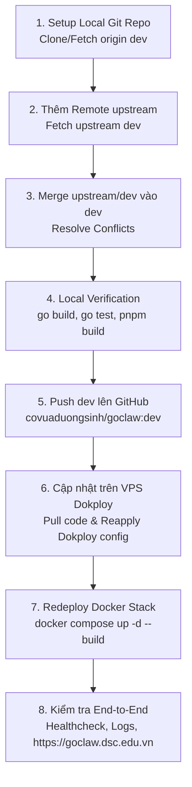

# Kế Hoạch Đồng Bộ Upstream Repo Goclaw Và Triển Khai Dokploy Trên VPS

- **Ngày tạo**: 16/11/2026
- **Trạng thái**: Chờ duyệt (Pending Approval)
- **Mục tiêu**:
  1. Khởi tạo và thiết lập repository local tại `D:\code\goclaw`.
  2. Đồng bộ các cập nhật mới nhất từ upstream (`nextlevelbuilder/goclaw:dev`, hơn 115 commit mới) vào nhánh `dev` của fork cá nhân (`covuaduongsinh/goclaw`).
  3. Bảo toàn và giải quyết xung đột với 3 commit tùy biến của fork (đặc biệt là tính năng xác thực email + mật khẩu `feat(auth): add email + password sign-in` và file compose Dokploy).
  4. Build & kiểm thử toàn diện trên môi trường local (Go backend + React frontend).
  5. Đẩy nhánh đã hợp nhất lên GitHub (`covuaduongsinh/goclaw:dev`).
  6. Đồng bộ và kích hoạt lại (redeploy) container GoClaw trên VPS Dokploy (`217.15.160.118`), kiểm tra domain `https://goclaw.dsc.edu.vn`.

---

## 1. Hiện trạng hệ thống (Current Status)

### A. Local (`D:\code\goclaw`)
- Hiện tại thư mục `D:\code\goclaw` chỉ có thư mục cache `.omc`, chưa khởi tạo git clone.
- Môi trường máy: Go `1.26.3`, Node `v24.18.0`, pnpm `11.25.0`, Git `2.56.1`.

### B. GitHub (`covuaduongsinh/goclaw` vs `nextlevelbuilder/goclaw`)
- **Fork**: `covuaduongsinh/goclaw` (nhánh mặc định `dev`).
- **Upstream**: `nextlevelbuilder/goclaw` (nhánh active `dev` cập nhật liên tục đến 15/11/2026, commit `ed8578e`).
- Upstream `dev` đang đi trước fork `dev` **115 commit** (bao gồm kênh Mattermost mới, cơ chế cron `due`/`force`, sửa token counting Gemini/Claude, xử lý UTF-8 wikilinks trong vault, v.v.).
- Fork của người dùng có **3 commit tùy biến riêng** chưa đưa vào upstream:
  1. `4d5b248` - `chore(deps): tidy go.mod/go.sum for ollama dependency`
  2. `bab263e` - `deploy: add merged compose file for Dokploy`
  3. `52a09a9` - `feat(auth): add email + password sign-in` (Rất quan trọng: Bảng `users`, migration `000098_user_accounts`, API auth, UI đăng nhập/quản trị user).

### C. VPS & Dokploy (`217.15.160.118`)
- Dokploy Compose App: `goclaw-prod-juw7fm` (Compose ID: `9G8ukrLUDADrfI5YifiSV`).
- Domain: `goclaw.dsc.edu.vn` (đang map qua Traefik port `18790`).
- Thư mục trên VPS: `/etc/dokploy/compose/goclaw-prod-juw7fm/code`.
- Tình trạng hiện tại trên VPS: Container đang chạy commit `bab263e` từ 26/08/2026 (chưa có cả commit `feat(auth)` lẫn 115 commit mới của upstream).
- Trong `docker-compose.dokploy.yml` trên VPS có các labels cấu hình Traefik và mạng `dokploy-network` do Dokploy tự động chèn vào.

---

## 2. Kế hoạch triển khai chi tiết (Step-by-Step Implementation)



### Bước 1: Khởi tạo và đồng bộ Local Repository (`D:\code\goclaw`)
1. Clone hoặc khởi tạo git trong `D:\code\goclaw`:
   - Giữ nguyên thư mục `.omc`.
   - Kết nối remote `origin`: `https://github.com/covuaduongsinh/goclaw.git`.
   - Checkout nhánh `dev`.
2. Thêm remote `upstream`: `https://github.com/nextlevelbuilder/goclaw.git`.
3. Fetch toàn bộ nhánh từ cả 2 remote (`origin` và `upstream`).

### Bước 2: Hợp nhất (Merge) Upstream vào Fork
1. Thực hiện merge `upstream/dev` vào nhánh `dev` local.
2. Dự kiến các vị trí có thể xảy ra xung đột (conflict):
   - `go.mod` và `go.sum`: Phiên bản thư viện và dependency. Cần chạy `go mod tidy` sau merge.
   - `cmd/gateway.go`, `cmd/root.go`, `internal/gateway/router.go`: Các điểm tích hợp middleware và router của tính năng auth `52a09a9` kết hợp với các route/channel mới của upstream.
   - `ui/web/src/routes.tsx` & sidebar/topbar: Tích hợp menu người dùng / admin song song với các menu mới (Mattermost channel).
   - `docker-compose.dokploy.yml`: Giữ nguyên cấu hình Dokploy tương thích với image build mới.
3. Giải quyết chi tiết từng conflict để không làm mất logic authentication `users` và email/password sign-in.

### Bước 3: Kiểm thử và Verify tại Local
1. Backend:
   - `go mod tidy`
   - `go build ./...`
   - Chạy bộ unit tests của backend: `go test ./internal/crypto/... ./internal/http/... ./tests/integration/...`
2. Frontend:
   - `cd ui/web && pnpm install && pnpm build`
   - Đảm bảo build Vite/TypeScript không có lỗi type hoặc missing imports.

### Bước 4: Đẩy code lên GitHub
1. Commit các thay đổi sau khi giải quyết conflict và test thành công.
2. Đẩy nhánh `dev` lên `covuaduongsinh/goclaw`:
   `git push origin dev`

### Bước 5: Cập nhật và kích hoạt lại trên VPS Dokploy
1. Truy cập SSH vào VPS `217.15.160.118`:
   - Chuyển vào `/etc/dokploy/compose/goclaw-prod-juw7fm/code`.
   - Backup file `docker-compose.dokploy.yml` hiện tại (chứa labels Traefik của Dokploy).
   - Thực hiện `git fetch origin` và `git checkout dev && git pull origin dev`.
   - Đảm bảo `docker-compose.dokploy.yml` có đầy đủ nhãn Traefik routing tới `goclaw.dsc.edu.vn` và mạng `dokploy-network`.
2. Chạy redeploy container:
   ```bash
   docker compose -p goclaw-prod-juw7fm -f ./docker-compose.dokploy.yml up -d --build --remove-orphans
   ```
3. Kiểm tra DB migrations:
   - GoClaw tự động chạy migration khi khởi động (trong đó có migration `000098_user_accounts` nếu chưa chạy trước đây).
   - Kiểm tra log container: `docker logs -f goclaw-prod-juw7fm-goclaw-1 --tail 50`.

### Bước 6: Kiểm tra nghiệm thu (Verification)
1. Kiểm tra trạng thái container:
   - `docker ps --filter name=goclaw` (cả app lẫn postgres đều `healthy`).
2. Kiểm tra truy cập HTTPS:
   - `curl -I -k https://goclaw.dsc.edu.vn` -> HTTP 200 OK.
3. Kiểm tra tính năng Web UI:
   - Màn hình đăng nhập hiển thị đầy đủ các tab (Token / Email + Password nếu có).
   - Kiểm tra log không có lỗi panic hay crash loop.

---

## 3. Quản lý tài liệu kế hoạch (Plan Archival Rule)
Theo yêu cầu:
- Kế hoạch này được lưu trữ chính thức tại: [docs/plans/2026-11-16-sync-and-deploy-goclaw.md](file:///D:/code/goclaw/docs/plans/2026-11-16-sync-and-deploy-goclaw.md)
- Mọi kế hoạch về sau sẽ tiếp tục tuân thủ quy tắc lưu tại thư mục `/docs/plans/`.
